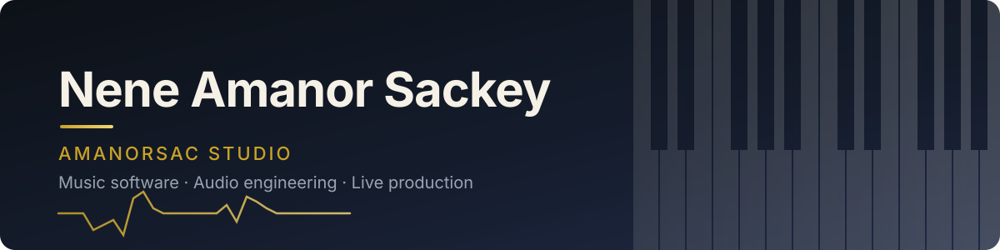

<!-- Banner -->

  

  

  
  
  

---

### 🎹 About me

I'm a music director, broadcast post engineer and pianist with **11+ years** in gospel and worship production — and I write the software I wish existed on stage and in the studio.

- 🎛️ Founder of **[Amanorsac Studio](https://amanorsac.com)** — audio plugins, practice tools and live-production apps
- 🛠️ Running **CTSD** (Custom Technology & Software Development) — custom apps for churches and businesses
- 🎓 Graduate study in music & worship at Liberty University
- 🌍 Roots in Ghana — gospel, highlife and Afro praise shape everything I build

---

### 🚀 Projects

<i>Source code is private. Every project below links to <a href="https://amanorsac.com">amanorsac.com</a>, where you can see demos, screenshots and downloads.</i>

#### 🎛️ Audio plugins (JUCE · VST3 / AU)

<table>
  <tr>
    <td width="50%" valign="top">
      <h4>✨ <a href="https://amanorsac.com">Aether</a></h4>
      Air-exciter plugin for vocals and mixes — open, musical top end without harshness. 
      C++ · JUCE
    </td>
    <td width="50%" valign="top">
      <h4>🥁 <a href="https://amanorsac.com">DrumGate</a></h4>
      Transparent gate for live and studio drums — tight, fast, no chatter. 
      C++ · JUCE
    </td>
  </tr>
  <tr>
    <td width="50%" valign="top">
      <h4>🔊 <a href="https://amanorsac.com">Lowend</a></h4>
      Low-frequency shaping and control for kick, bass and the sub region. 
      C++ · JUCE
    </td>
    <td width="50%" valign="top">
      <h4>📐 <a href="https://amanorsac.com">Align Pro</a></h4>
      Phase and time alignment for multi-mic sources. 
      C++ · JUCE
    </td>
  </tr>
  <tr>
    <td width="50%" valign="top">
      <h4>🌌 <a href="https://amanorsac.com">Nebula Tide</a></h4>
      Ambient reverb and modulation for pads, keys and worship textures. 
      C++ · CMake
    </td>
    <td width="50%" valign="top">
      <h4>🎚️ <a href="https://amanorsac.com">Audio Plugins Suite</a></h4>
      Growing collection of Amanorsac Studio processors. 
      C++ · JUCE
    </td>
  </tr>
</table>

#### 🎹 Practice & teaching tools

<table>
  <tr>
    <td width="50%" valign="top">
      <h4>🎹 <a href="https://amanorsac.com">ChordLight 88</a></h4>
      Real-time 88-key MIDI display that names the chords you play — for teaching, streaming and rehearsal. 
      JavaScript · Web MIDI
    </td>
    <td width="50%" valign="top">
      <h4>⏱️ <a href="https://amanorsac.com">Perfect Metronome</a></h4>
      A simple but powerful metronome for iPhone, iPad, Windows and Mac. 
      C++ · JUCE
    </td>
  </tr>
  <tr>
    <td width="50%" valign="top">
      <h4>🎓 <a href="https://amanorsac.com">MusicTutor</a></h4>
      Lesson studio for music teachers — scheduling, materials and student progress. 
      TypeScript
    </td>
    <td width="50%" valign="top">
      <h4>🎼 <a href="https://amanorsac.com">Piano Tutor</a></h4>
      Guided piano practice for beginners and worship keys players. 
      App
    </td>
  </tr>
  <tr>
    <td width="50%" valign="top">
      <h4>🌊 <a href="https://amanorsac.com">Pulse Room</a></h4>
      Interactive delay / reverb and plugin-chain trainer that teaches time-based effects by ear. 
      JavaScript · Web Audio
    </td>
    <td width="50%" valign="top">
      <h4>🎧 <a href="https://amanorsac.com">HarmonieMD</a></h4>
      Music-director companion for charts, keys and rehearsal notes. 
      JavaScript
    </td>
  </tr>
</table>

#### 🎤 Live production & stage

<table>
  <tr>
    <td width="50%" valign="top">
      <h4>🎚️ <a href="https://amanorsac.com">PerformLive</a></h4>
      Live-performance host for plugins, backing tracks and scene changes. 
      C++ · JUCE
    </td>
    <td width="50%" valign="top">
      <h4>🎧 <a href="https://amanorsac.com">MixMyIEM</a></h4>
      Personal in-ear monitor mixing for worship teams and bands. 
      JavaScript
    </td>
  </tr>
  <tr>
    <td width="50%" valign="top">
      <h4>⏭️ <a href="https://amanorsac.com">SecondOut</a></h4>
      Second-output routing and monitoring utility for live rigs. 
      C++
    </td>
    <td width="50%" valign="top">
      <h4>🎶 <a href="https://amanorsac.com">Asaph Choir</a></h4>
      Tools and resources for choir directors and vocal teams. 
      App
    </td>
  </tr>
</table>

#### 🧩 Studio utilities

<table>
  <tr>
    <td width="50%" valign="top">
      <h4>🧩 <a href="https://amanorsac.com">Stem Separator</a></h4>
      Split full mixes into stems for practice, remixing and live playback. 
      JavaScript · ML
    </td>
    <td width="50%" valign="top">
      <h4>🗂️ <a href="https://amanorsac.com">Stem Sorter</a></h4>
      Automatically organises and labels stems and bounces. 
      Python
    </td>
  </tr>
  <tr>
    <td width="50%" valign="top">
      <h4>📥 <a href="https://amanorsac.com">NovaGrab</a></h4>
      Fast media grabber for rehearsal references and post work. 
      Rust
    </td>
    <td width="50%" valign="top">
      <h4>📄 <a href="https://amanorsac.com">PDF Tools</a></h4>
      Chart and document utilities for the music office. 
      JavaScript
    </td>
  </tr>
</table>

#### 🌐 Web platforms & client work

<table>
  <tr>
    <td width="50%" valign="top">
      <h4>🛠️ <a href="https://amanorsac.com">CTSD — Custom Technology & Software Development</a></h4>
      Custom apps and websites for churches and businesses. 
      JavaScript · Cloudflare
    </td>
    <td width="50%" valign="top">
      <h4>🎓 <a href="https://amanorsac.com">Modern Music Hub</a></h4>
      Website for a piano and music-production academy in Charlottesville. 
      JavaScript
    </td>
  </tr>
  <tr>
    <td width="50%" valign="top">
      <h4>⛪ <a href="https://amanorsac.com">FCCI Preview</a></h4>
      Church website redesign preview by CTSD. 
      HTML · CSS
    </td>
    <td width="50%" valign="top">
      <h4>🌍 <a href="https://amanorsac.com">GRITS</a></h4>
      TypeScript platform project. 
      TypeScript
    </td>
  </tr>
</table>

<a href="https://amanorsac.com"><b>See everything at amanorsac.com →</b></a>

---

### 🧰 Tech stack

  

  
  
  
  
  

---

### 📊 GitHub stats

  
  

  

---

  <i>“Excellence in the room, on the stage, and in the code.”</i>

